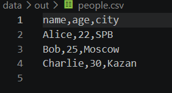
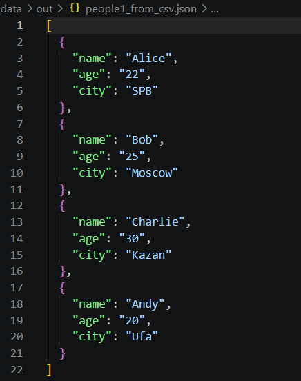
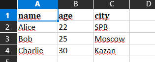

# ЛР5 - JSON и конвертации (JSON↔CSV, CSV→XLSX)
## Задание А
- **`_check_input` / `_check_output`** — проверяют расширения файлов, существование входного файла и создают выходные папки при необходимости.
- **`_cell`** — преобразует значения ячеек в строки для CSV (заменяет `None` на `""`, а вложенные списки/словари — в JSON-строку).
- **`json_to_csv`** — читает JSON-список словарей в UTF-8, собирает все уникальные ключи как заголовки и записывает строки в CSV-таблицу.
- **`csv_to_json`** — читает CSV-файл с обязательным заголовком, преобразует каждую строку в словарь и сохраняет результат в форматированный JSON.

### Тест json -> csv

### Тест csv -> json

## Задание B
модуль csv_xlsx.py преобразует CSV-таблицу в Excel-файл с валидацией данных и автоматическим форматированием через библиотеку openpyxl.
функция csv_to_xlsx(csv_path, xlsx_path) выполняет следующие шаги:
 - проверяет расширения (.csv и .xlsx) через Path.suffix, существование исходного файла (Path.is_file()) и наличие непустой строки заголовка после чтения через csv.reader()
 - инициализирует Excel-книгу (Workbook()), задаёт имя активного листа Sheet1 (ws.title = "Sheet1") и построчно переносит записи методом ws.append()
 - выделяет ячейки первой строки жирным шрифтом (Font(bold=True)), определяет буквенные имена столбцов с помощью get_column_letter() и выставляет автоширину каждого столбца не менее MIN_WIDTH (8 символов) с запасом в 2 символа (max(MIN_WIDTH, longest + 2)).
 - создаёт недостающие родительские папки (dst.parent.mkdir(...)) и записывает итоговый файл на диск методом wb.save().

### Тест csv -> xlsx
