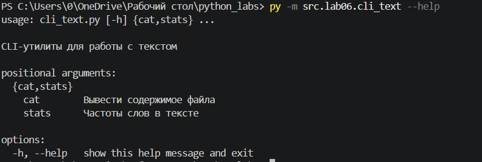
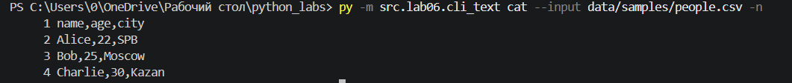
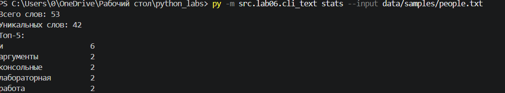
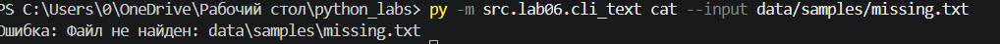
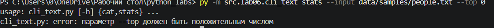
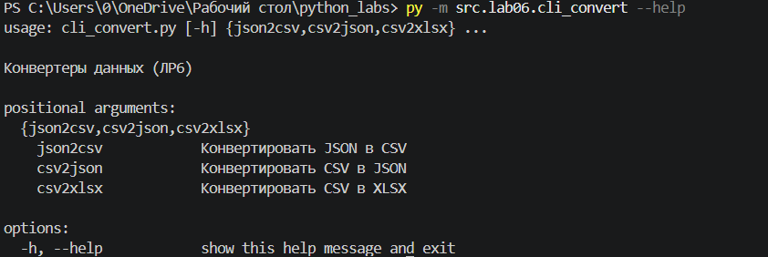
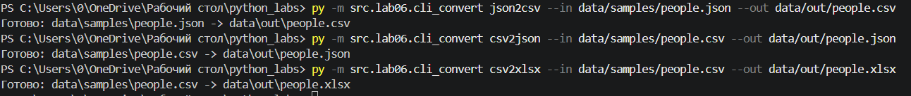
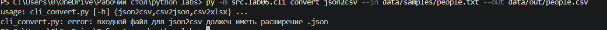
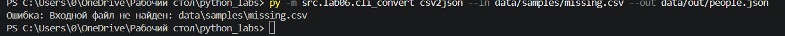

# ЛР6 - CLI‑утилиты с argparse (cat/grep‑lite + конвертеры)

## Модуль cli_text.py с подкомандами
Модуль cli_text.py создаёт консольную утилиту на базе argparse для построчного вывода файлов и частотного анализа текста в кодировке UTF-8.
### Подкоманды парсера (argparse)
1. **`cat`** — выводит содержимое файла построчно:
   * `--input <путь>` — обязательный путь к входному файлу;
   * `-n` — необязательный флаг для нумерации строк.

2. **`stats`** — выводит статистику частот слов в тексте:
   * `--input <путь>` — обязательный путь к текстовому файлу;
   * `--top <число>` — необязательное количество топ-слов для вывода (по умолчанию `5`).

### Справка

### Работа

### Ошибки
#### Файл не найден

#### Неверное t

## Модуль cli_convert.py с подкомандами
### Подкоманды парсера (argparse)
Все три подкоманды принимают два обязательных параметра: --in <путь> (входной файл) и --out <путь> (выходной файл):
 - json2csv — конвертирует .json в .csv (вызывает json_to_csv)
 - csv2json — конвертирует .csv в .json (вызывает csv_to_json)
 - csv2xlsx — конвертирует .csv в .xlsx (вызывает csv_to_xlsx)
### Справка

### Работа

### Ошибки
#### Неверное расширение

#### Нет файла
