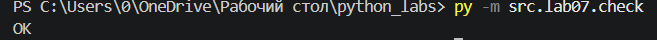
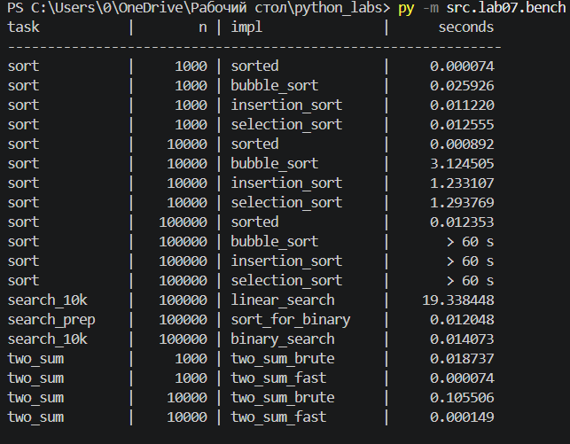

# ЛР7 — Поиск, сортировка и измерение времени
## Задание А
- linear_search(nums, x) — идёт по списку слева направо и возвращает индекс первого встреченного x (или -1, если элемента нет).
- binary_search(sorted_nums, x) — находит x в отсортированном списке, на каждом шаге деля область поиска пополам через границы lo и hi.
- two_sum_brute(nums, target) — ищет два индекса (i, j), элементы которых в сумме дают target, через полный перебор всех пар двумя вложенными циклами. 
- two_sum_fast(nums, target) — решает ту же задачу за один проход: запоминает просмотренные числа в словаре {число: индекс} и для текущего x мгновенно проверяет наличие target - x. 

## Задание B
- bubble_sort(nums) — сравнивает соседние элементы и меняет их местами, если они стоят не по порядку, «выталкивая» максимум в конец. Имеет флаг swapped для досрочного выхода, если список уже отсортирован.
- insertion_sort(nums) — берёт очередной элемент и сдвигает его влево в уже отсортированную часть списка, пока не найдёт для него правильное место.
- selection_sort(nums) — на каждом шаге ищет минимальный элемент в оставшейся неотсортированной части и меняет его местами с первым элементом этой части.

## Задание C
- check_sorting(fn, trials=100) — генерирует 100 случайных списков и через assert проверяет, что fn(nums) совпадает с эталонным sorted(nums), а исходный список не изменился.
- check_search(trials=100) — проверяет linear_search против list.index, а binary_search — на отсортированных списках (включая пустые списки, крайние элементы и отсутствующие числа).
- check_two_sum(trials=100) — сравнивает ответы two_sum_brute и two_sum_fast на 100 случайных наборах, проверяя совпадение None и корректность найденной пары индексов.

Запсук:
``` bash
py -m src.lab07.check
```


## Задание D
- read_numbers(path) — читает столбец "value" из CSV-файла и возвращает список целых чисел.
- get_data(n) — загружает тестовый набор из файла через read_numbers или генерирует случайный список из n чисел, если файла нет.
- bench_sorts(n) — замеряет через timeit скорость sorted и трёх ручных сортировок на одном и том же списке размера n 
- bench_search() — замеряет время выполнения 10 000 запросов линейным поиском, время предварительной сортировки и время 10 000 запросов бинарным поиском на списке из 100 000 элементов.
- bench_two_sum() — сравнивает время поиска гарантированно существующей пары между two_sum_brute и two_sum_fast на n = 1,000 и 10,000.
- main() — объединяет все замеры, выводит выровненную таблицу в консоль и сохраняет её в data/lab07/bench.csv через функцию write_csv из ЛР4.

Запуск:
``` bash
py -m src.lab07.bench
```



## Результаты бенчмарка (`bench.py`)

Замеры выполнены через модуль `timeit` при фиксированном `random.seed(42)`. Исходные данные сохранены в data/lab07/bench.csv

| Задача (`task`) | Объём (`n`) | Алгоритм (`impl`) | Время (`seconds`) |
|:-----|--:|:----------|-----------:|
| Sort | 1 000 | `sorted` | 0.000074 |
| Sort | 1 000 | `bubble_sort` | 0.025926 |
| Sort | 1 000 | `insertion_sort` | 0.011220 |
| Sort | 1 000 | `selection_sort` | 0.012555 |
| Sort | 10 000 | `sorted` | 0.000892 |
| Sort | 10 000 | `bubble_sort` | 3.124505 |
| Sort | 10 000 | `insertion_sort` | 1.233107 |
| Sort | 10 000 | `selection_sort` | 1.293769 |
| Sort | 100 000 | `sorted` | 0.012353 |
| Sort | 100 000 | `bubble_sort` | > 60 |
| Sort | 100 000 | `insertion_sort` | > 60 |
| Sort | 100 000 | `selection_sort` | > 60 |
| Search | 100 000 | `linear_search` (10k запросов) | 19.338448 |
| Search | 100 000 | `sort_for_binary` | 0.012048 |
| Search | 100 000 | `binary_search` (10k запросов) | 0.014073 |
| Two Sum | 1 000 | `two_sum_brute` | 0.018737 |
| Two Sum | 1 000 | `two_sum_fast` | 0.000074 |
| Two Sum | 10 000 | `two_sum_brute` | 0.105506 |
| Two Sum | 10 000 | `two_sum_fast` | 0.000149 |

## Вывод
 - Сортировки: при увеличении массива с 1 000 до 10 000 элементов Bubble Sort замедлился примерно в 120 раз, Insertion Sort — в 110 раз, Selection Sort — в 103 раза. Это подтверждает их квадратичную сложность O(n²). При этом sorted() показал гораздо более медленный рост времени: примерно в 12–14 раз при увеличении массива в 10 раз. На 100 000 элементах три простые сортировки не уложились даже в 60 секунд.
 - Поиск: Linear Search для 10 000 запросов занял 19,34 секунды. Подготовка данных для Binary Search и выполнение 10 000 запросов вместе заняли около 0,026 секунды. Таким образом, бинарный поиск с предварительной сортировкой оказался примерно в 740 раз быстрее. Это показывает, что сортировка особенно выгодна, когда по одному массиву выполняется много поисковых запросов.
 - Two Sum: оптимизированная версия с использованием словаря показала значительно лучшие результаты, чем перебор. Для 1 000 элементов Fast выполнился за 0,000074 секунды против 0,018737 секунды у Brute Force. На 10 000 элементах разница также сохранилась: 0,000149 секунды против 0,105506 секунды.